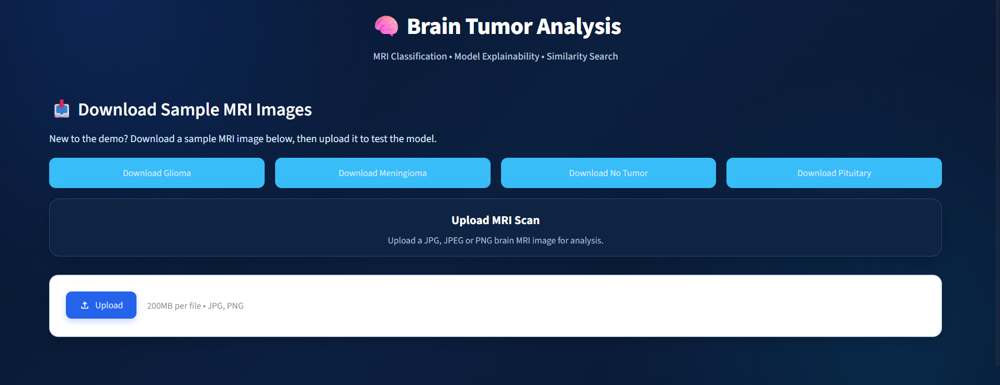
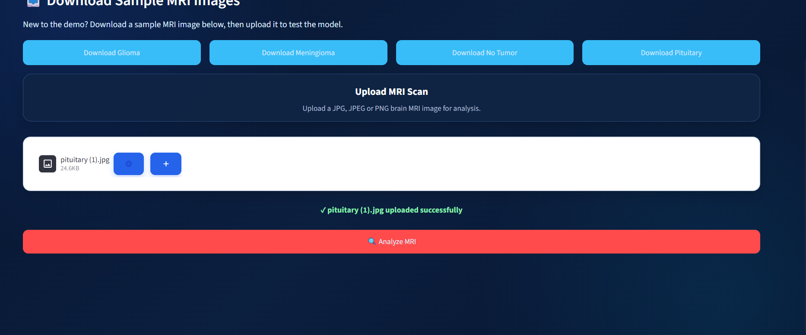
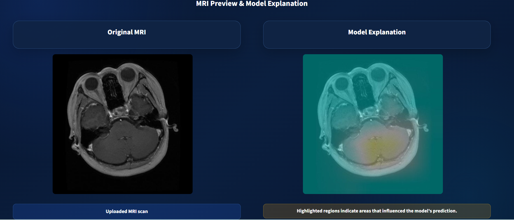
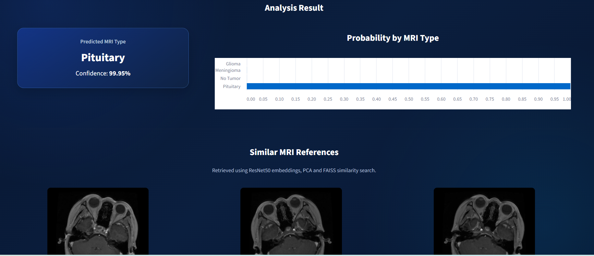
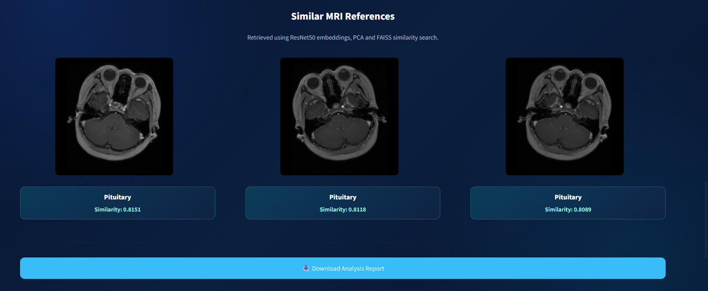

# Brain Tumor Classification & MRI Similarity Search

A computer vision research project that classifies brain MRI images into four categories, generates Grad-CAM visual explanations, and retrieves visually similar MRI references using deep feature embeddings, PCA, and FAISS.

> **Research prototype only.** This system is not intended for clinical diagnosis or treatment decisions.

**Tech Stack:** Python • ResNet50 • TensorFlow/Keras • Grad-CAM • PCA • FAISS • FastAPI • Streamlit

## Application Demo

### 1. Application Interface

The Streamlit interface allows users to select sample MRI images or upload an image for analysis.



### 2. MRI Upload

Users can upload an MRI image and initiate the analysis through the application interface.



### 3. Model Explainability with Grad-CAM

Grad-CAM generates a heatmap that highlights image regions influencing the model's prediction. This provides a visual explanation of the model's behavior.



### 4. Classification Results

The fine-tuned ResNet50 model classifies an MRI into one of four categories:

- Glioma
- Meningioma
- Pituitary
- No Tumor

The application displays the predicted class and class-wise probability scores.



### 5. Similar MRI Retrieval and Analysis Report

The application retrieves visually similar MRI references using deep feature embeddings, PCA dimensionality reduction, and FAISS similarity search. Users can also download an analysis report.



## Key Features

- **Four-class MRI classification** using a fine-tuned ResNet50 model.
- **Transfer learning and fine-tuning** using TensorFlow/Keras.
- **Class-wise probability scores** for model predictions.
- **Grad-CAM visualization** for interpreting model predictions.
- **Deep feature extraction** for MRI image representations.
- **PCA dimensionality reduction** for feature embeddings.
- **FAISS similarity search** to retrieve visually similar MRI references.
- **FastAPI backend** for model inference and related functionality.
- **Streamlit frontend** for interactive MRI analysis.
- **Analysis report download** from the application interface.

## Model Evaluation

The final fine-tuned model was evaluated on a held-out test set of 1,000 MRI images.

| Metric | Final fine-tuned model |
|---|---:|
| Test samples | 1,000 |
| Correct predictions | 946 |
| Incorrect predictions | 54 |
| Test accuracy | 94.60% |
| Macro F1-score | 94.96% |
| Glioma recall | 90.16% |

### Baseline vs. Fine-Tuned ResNet50

| Metric | Frozen ResNet50 baseline | Fine-tuned ResNet50 |
|---|---:|---:|
| Test accuracy | 92.40% | 94.60% |
| Macro F1-score | 93.00% | 94.96% |
| Glioma recall | 79.53% | 90.16% |
| Correct test predictions | 924/1,000 | 946/1,000 |

The results show improved classification performance and glioma recall after fine-tuning on the evaluated test set.

**Evaluation note:** These results represent performance on the specific test set used in this project. They do not establish clinical validity or guarantee performance on MRI images from other sources.

## Technical Architecture

```text
                 User
                  |
                  v
          Streamlit Web UI
                  |
                  v
             FastAPI API
                  |
          Uploaded MRI Image
                  |
          +-------+--------+
          |                |
          v                v
   ResNet50 Classifier   Grad-CAM
          |                |
          v                v
   Class Probabilities  Heatmap
          |
          v
   ResNet50 Feature Embeddings
          |
          v
   PCA Dimensionality Reduction
          |
          v
      FAISS Similarity Search
          |
          v
   Similar MRI References
          |
          v
     Analysis Report
```

### Component Responsibilities

| Component | Responsibility |
|---|---|
| ResNet50 | MRI classification and deep feature extraction |
| TensorFlow/Keras | Model training, fine-tuning, and inference |
| Grad-CAM | Visual explanation of predictions |
| PCA | Dimensionality reduction of extracted embeddings |
| FAISS | Similarity search over indexed MRI features |
| FastAPI | Backend API and inference services |
| Streamlit | Interactive user interface |

## Machine Learning Workflow

The project follows a structured workflow covering data preparation, model development, evaluation, and application integration.

1. Dataset ingestion and organization.
2. Data validation and schema checks.
3. Exploratory data analysis.
4. ResNet50 model preparation and fine-tuning.
5. Model evaluation and error analysis.
6. Deep feature extraction for MRI images.
7. PCA-based feature dimensionality reduction.
8. FAISS index preparation for similarity search.
9. FastAPI inference service integration.
10. Grad-CAM visualization.
11. Streamlit interface integration.

The application uses the final inference model:

`artifacts/model_trainer/resnet50_finetuned.keras`

The candidate model is separate and is intended for evaluation and model selection rather than final inference.

## Repository Structure

The repository separates configuration, reusable code, pipeline stages, the API, the application interface, and documentation.

```text
brain_tumor_detection/
├── app.py
├── config/
├── docs/
│   └── screenshots/
│       ├── 01_app_interface.png
│       ├── 02_mri_upload.png
│       ├── 03_gradcam_explanation.png
│       ├── 04_prediction_results.png
│       └── 05_similarity_and_report.png
├── scripts/
├── src/
│   └── brain_tumor_detection/
│       ├── components/
│       ├── configuration/
│       ├── constants/
│       ├── entity/
│       ├── pipelines/
│       ├── utils/
│       └── api/
│           └── main.py
├── research/
├── requirements.txt
├── .gitignore
├── .python-version
└── README.md
```

*This is a high-level representation. The repository may contain additional modules and files within these directories.*

## Local Setup

### Prerequisites

- Python 3.11
- Git
- Required project dependencies
- Model artifacts and reference MRI data for the complete application workflow

### 1. Clone the repository

```bash
git clone https://github.com/suvarna03/brain_tumor_detection.git
cd brain_tumor_detection
```

### 2. Create and activate a virtual environment

For Windows:

```bash
py -3.11 -m venv .venv
.venv\Scripts\activate
```

### 3. Install dependencies

```bash
python -m pip install --upgrade pip
pip install -r requirements.txt
```

### 4. Prepare the required artifacts

The trained model and supporting artifacts must be available in the expected project directories.

| Artifact | Purpose |
|---|---|
| `artifacts/model_trainer/resnet50_finetuned.keras` | Final classification model |
| `artifacts/pca/pca.pkl` | Fitted PCA transformation |
| `artifacts/faiss_index/faiss.index` | FAISS similarity-search index |
| `artifacts/faiss_index/metadata.pkl` | Metadata for indexed MRI references |

The reference MRI images must also be available in the expected data directory for similar-image retrieval and reference-image display.

### 5. Start the FastAPI backend

Open a terminal in the project root and run:

```bash
uvicorn src.brain_tumor_detection.api.main:app --reload
```

The API runs locally at:

`http://127.0.0.1:8000`

Interactive API documentation:

`http://127.0.0.1:8000/docs`

### 6. Start the Streamlit application

Open a second terminal in the project root, activate the same virtual environment, and run:

```bash
streamlit run app.py
```

Open the local URL displayed in the terminal, usually:

`http://localhost:8501`

Keep the FastAPI backend running while using the Streamlit application.

## Application Workflow

1. Open the Streamlit interface.
2. Select a sample MRI image or upload an image.
3. Run the analysis.
4. Review the predicted class and probability scores.
5. Inspect the Grad-CAM visualization.
6. Review the retrieved similar MRI references.
7. Download the analysis report.

## Limitations and Responsible Use

- This is an educational and research prototype, not a clinically validated diagnostic system.
- Model predictions and probability scores should not be interpreted as medical certainty.
- Grad-CAM highlights regions influencing the model's output; it does not prove that a highlighted region contains a tumor.
- Similarity search identifies visually similar reference images and does not establish clinical equivalence.
- Test-set performance may not generalize to MRI images from different scanners, institutions, or populations.
- The complete application requires the appropriate model artifacts and reference data to be available locally.
- Dataset usage and redistribution must comply with the original dataset's licence and terms.

## Future Improvements

- Automated tests for API endpoints and inference workflows.
- Additional robustness evaluation across MRI data sources.
- Inference latency and resource-usage benchmarking.
- Improved artifact versioning and reproducibility.
- Optional public demonstration hosting, subject to suitable free-tier availability.

## Acknowledgements

This project uses the BRISC 2025 brain MRI dataset. Please refer to the original dataset source for its documentation, licence, and permitted use.

## Author

**Suvarna Gawali**

- GitHub: [@suvarna03](https://github.com/suvarna03)
- Project repository: [brain_tumor_detection](https://github.com/suvarna03/brain_tumor_detection)

---

> **Research prototype only.** This system is not intended for clinical diagnosis or treatment decisions.
